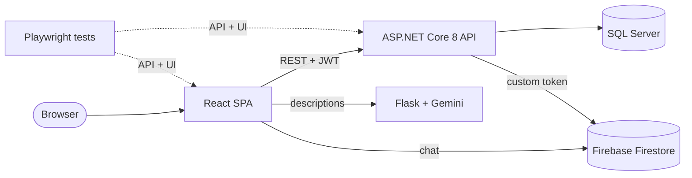

# PetStore

[](https://github.com/elifbarlik/PetStore/actions/workflows/tests.yml)

A full-stack pet adoption platform: users publish listings with photos, browse and search them,
adopt pets and chat with owners. It ships with an automated Playwright test suite (REST API + UI)
that runs on every push.



## Backend — `back_end/` (ASP.NET Core 8, EF Core, SQL Server)

- **Auth:** ASP.NET Identity + JWT; password policy, brute-force lockout (5 attempts / 5 min), no account enumeration.
- **Authorization:** the caller is always taken from the JWT; only owners can update, delete or cancel the adoption of their listings (`403` otherwise).
- **Listings:** CRUD with image upload validated by extension, file signature (magic bytes) and size (5 MB); saved inside a DB transaction.
- **Adoption:** atomic update, so concurrent requests cannot both win; adopted listings can't be deleted until the adoption is cancelled.
- **API contract:** one `ResponseDto` envelope whose `statusCode` always equals the HTTP status; field-level validation errors; global exception handler.
- **Ops:** Serilog (console + Seq), Swagger, UTC timestamps, 0 build warnings, no vulnerable packages, no secrets in the repo.

## Frontend — `front_end/` (React 19, TypeScript, Vite, Redux Toolkit, Tailwind)

- Login/register with zod validation; protected routes; return to the requested page after login.
- Expired tokens are detected at startup and on any `401`; logout also ends the Firebase session.
- Listing search (Turkish-locale aware) and filters, detail page, adoption, profile management with toasts and in-dialog errors.
- Accessible markup (real links, labelled buttons) and route-level code splitting (28 kB entry chunk).

## Tests — `tests/` (Playwright, TypeScript)

| Suite | Tests | Covers |
|---|---|---|
| API | 55 | Auth & lockout, validation, uploads, ownership (403), adoption concurrency, HTTP status contract |
| UI | 37 | Login/register, protected routes & sessions, browse/search/filter, adoption, create/delete/cancel on the profile |
| Load (JMeter) | 1 plan | `GetAllPosts`: 5 000 requests, p99 4 ms, 0 % errors |

- **Page Object Model** and typed API clients; specs contain no raw selectors or URLs.
- **Isolated data:** each test creates its own users/posts and cleans up; a separate `PetStore_Test` database is used.
- **One command:** Playwright starts the API and the frontend itself.
- **CI (GitHub Actions):** frontend lint + build, backend build, type-check, full suite; HTML report, JUnit summary and failure screenshots/videos/traces as artifacts.
- Test plan, test cases and the defect log (9 findings, all fixed with regression tests): [`tests/TEST_PLAN.md`](tests/TEST_PLAN.md).

## Getting started (Windows)

Prerequisites: .NET 8, Node.js 20+, SQL Server LocalDB, Python 3.10+ (AI service only).

**Backend**
```powershell
cd back_end/PetStoreAPI/PetStoreAPI
dotnet tool restore
dotnet user-secrets set "ApiSettings:JwtOptions:Secret" "<random string, 32+ chars>"   # once
dotnet ef database update
dotnet run --launch-profile http          # http://localhost:5294/swagger
```
For chat, place a Firebase service-account key at `back_end/PetStoreAPI/firebase-service-account.json` (git-ignored).

**Frontend**
```powershell
cd front_end
npm ci
npm run dev                               # http://localhost:5173
```
Create `front_end/.env` with `VITE_FIREBASE_API_KEY`, `VITE_FIREBASE_AUTH_DOMAIN`, `VITE_FIREBASE_PROJECT_ID`,
`VITE_FIREBASE_STORAGE_BUCKET`, `VITE_FIREBASE_MESSAGING_SENDER_ID`, `VITE_FIREBASE_APP_ID`
(and `VITE_FIREBASE_DB_ID` if your Firestore database is not `(default)`). Chat security rules: [`firestore.rules`](firestore.rules).

**AI service (optional)**
```powershell
cd ai
py -3 -m venv venv; venv\Scripts\activate
pip install -r requirements.txt
$env:GEMINI_API_KEY="..."; python app.py  # http://127.0.0.1:5000
```

**Tests**
```powershell
cd tests
npm ci
npx playwright install chromium
npm run db:setup                          # first time only
npm test                                  # report: tests/playwright-report
```
